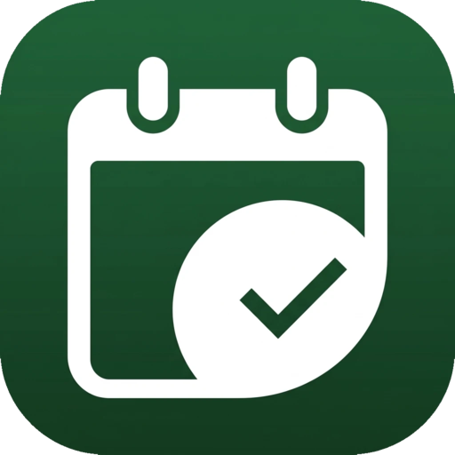

<div align="center">



# TimeLog

**Vos heures, votre journal de travail et vos notes, au même endroit.**
Simple, hors ligne, et vos données restent à vous.

[](LICENSE)


</div>

---

TimeLog remplace la feuille de calcul des heures, le carnet de notes et le journal de travail
par une seule application claire, pensée pour tout le monde, sans connaissances en informatique.
Pointez en un toucher, voyez immédiatement votre solde d'heures, gardez une trace de ce que
vous avez fait et retrouvez n'importe quelle note en quelques secondes.

## Pourquoi TimeLog

- **Pointer en une seconde** : un bouton dans l'application, ou directement depuis le
  **widget de l'écran d'accueil**, sans même ouvrir l'app.
- **Votre solde, toujours à jour** : heures en plus ou en moins par jour, semaine, mois,
  année, et au total.
- **Vacances et absences sans calcul** : droit annuel, report, jours restants,
  demi-journées, maladie, jours fériés.
- **Tout en un** : heures, journal de travail, notes, photos, audio, dessins et documents.
- **Hors ligne d'abord** : tout fonctionne sans réseau, dans une base SQLite sur l'appareil.
- **Synchronisation optionnelle** entre téléphone et ordinateur, sur **votre propre serveur**.
- **Libre et sans publicité** : code source ouvert sous licence GPL v3, aucun pistage.

## Fonctionnalités

### ⏱️ Heures
- Pointage de l'arrivée, de la pause de midi et du départ ; le bouton **Pointer** remplit
  automatiquement l'étape suivante.
- Calcul automatique du temps travaillé, du solde positif ou négatif et du solde total.
- Vue par jour, semaine, mois ou année.
- Objectif journalier, jours travaillés et date de début du calcul réglables.

### 🏖️ Vacances et absences
- Vacances, maladie / accident, jour férié, récupération : journée entière, matin,
  après-midi ou durée personnalisée (ex. malade à partir de 10 h).
- Absence sur plusieurs jours en une fois (seuls les jours travaillés sont comptés).
- Droit annuel de vacances, report de l'année précédente en un clic, jours pris,
  planifiés et restants. Le solde restant s'affiche avant de valider une demande.

### 📱 Widget Android
- Widget 4×2 pour timbrer depuis l'écran d'accueil : arrivée → pause → reprise → départ.
- Affiche les heures du jour et le temps travaillé en direct.
- Gère les demi-journées et les absences, et ignore les doubles touchers.

### 📓 Journal de travail
- Entrées illimitées en **Markdown** (barre d'outils et aperçu).
- Temps passé et catégorie facultatifs.
- Mode *Ajout* et mode *Consultation* par jour, semaine, mois ou année, avec le temps total.

### 🗒️ Notes
- Texte, photos (appareil photo ou galerie), enregistrements audio, dessins et documents importés.
- Notes liées au jour, catégories, et recherche dans le texte, les titres, les noms de
  fichiers et les catégories.

### ✏️ Dessin
- Dessins **vectoriels**, rééditables à tout moment ; export en PNG.
- Stylo sensible à la vitesse (et à la pression avec un stylet), trait, flèche, rectangle,
  cercle, arc, remplissage, gommes, annuler / rétablir.

### 🔄 Synchronisation (optionnelle)
- Compte e-mail + mot de passe sur votre serveur **Go + MariaDB**, déployé en une commande
  avec Docker ([server/](server/README.md)).
- Fusion intelligente, champ par champ : pointez l'arrivée sur le téléphone et le départ
  sur l'ordinateur, rien ne se perd.

### 📤 Export et sauvegarde
- **Toutes** les données en JSON (un fichier, restaurable) ou en CSV (archive ZIP avec un
  fichier par table et les pièces jointes).

### 🎨 Personnalisation
- Thème clair, sombre ou système, couleur d'accent au choix (appliquée aussi au widget).
- Français, allemand, italien et anglais ; format 24 h ou 12 h ; premier jour de la semaine.

## Installation

### Android
Compiler l'APK puis l'installer sur le téléphone :

```bash
cd app
flutter build apk --release
# build/app/outputs/flutter-apk/app-release.apk
```

### Linux
```bash
cd app
flutter build linux --release
linux/install-desktop-entry.sh   # ajoute TimeLog au menu des applications
```

Dépendances système : `libsqlite3`, GStreamer, et `parecord` ou `ffmpeg` pour l'audio.

### Serveur de synchronisation (facultatif)
```bash
cd server
cp .env.example .env   # choisir des mots de passe
docker compose up -d --build
```

Puis, dans l'application : menu **Synchronisation** → adresse du serveur, e-mail et mot de passe.
Détails, HTTPS et sécurité : [server/README.md](server/README.md).

## Organisation du dépôt

| Dossier | Contenu |
|---|---|
| [app/](app) | application Flutter (Android, Linux) et widget Android natif |
| [server/](server) | serveur de synchronisation Go + MariaDB (Docker) |
| [docs/](docs) | documentation technique |

## Documentation

| | |
|---|---|
| [docs/DEVELOPPEMENT.md](docs/DEVELOPPEMENT.md) | compiler, tester, structure du code, ajouter une langue |
| [docs/SYNC.md](docs/SYNC.md) | fonctionnement de la synchronisation hors ligne d'abord |
| [server/README.md](server/README.md) | déployer le serveur |
| [server/API.md](server/API.md) | API du serveur |

## Contribuer

Les signalements de bugs, idées et contributions sont les bienvenus. Avant de proposer une
modification, lancer `dart analyze` et `flutter test` dans `app/` (voir [docs/DEVELOPPEMENT.md](docs/DEVELOPPEMENT.md)).
Ajouter une langue ne demande qu'un fichier de traduction.

## Licence

TimeLog est un logiciel libre distribué sous les termes de la
[GNU General Public License v3.0](LICENSE).
Vous pouvez l'utiliser, l'étudier, le modifier et le redistribuer, à condition que les
versions modifiées restent sous la même licence.

© Lukas Hofer · [lukas.hofer.ju@gmail.com](mailto:lukas.hofer.ju@gmail.com)
